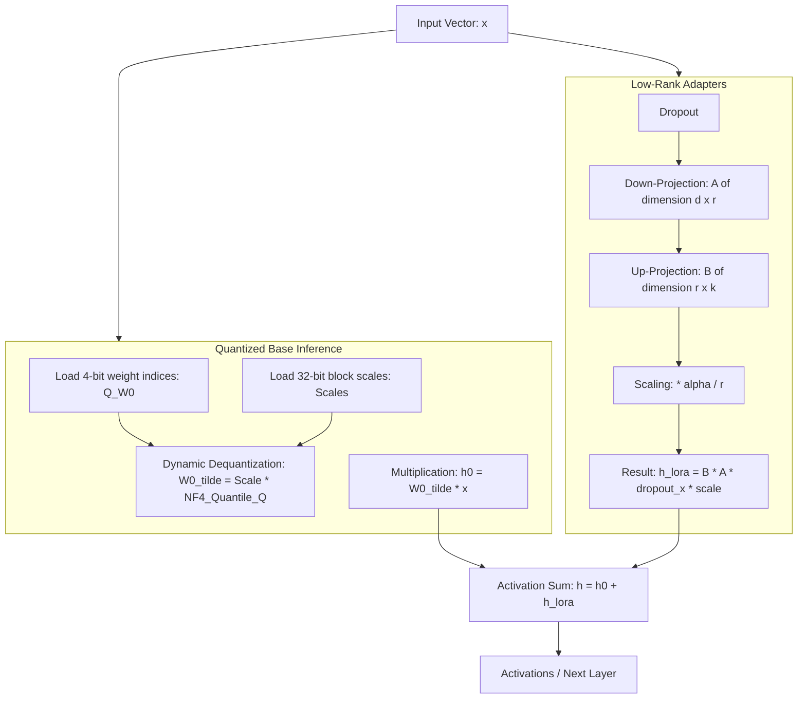

# LLM QLoRA Finetuner

Modular, high-performance, and efficient pipeline for fine-tuning language models via Low-Rank Adaptation (LoRA) and 4-bit quantization (QLoRA) in PyTorch, designed to optimize graphics memory (VRAM) usage on resource-constrained hardware.

This module natively implements low-rank adapter layer injection and block-by-block quantization under the NormalFloat4 (NF4) format proposed by Tim Dettmers et al. (2023), allowing the compression and execution of quantized models to be emulated without relying on third-party compiled CUDA binary libraries.

## Theoretical Foundations and Compute Architecture

QLoRA optimization reduces the base model's memory requirements by approximately 75% by quantizing its static tensors, while injecting trainable low-rank matrices that capture the fine-tuning gradients.



### 1. Low-Rank Adaptation (LoRA)

During fine-tuning, instead of updating the model's full parameter matrix $W_0 \in \mathbb{R}^{d \times k}$ (which requires a large amount of memory to store the optimizer's moments), LoRA freezes $W_0$ and decomposes the update matrix $\Delta W$ into two trainable low-rank matrices $A$ and $B$:

$$W = W_0 + \Delta W = W_0 + \frac{\alpha}{r} (B \cdot A)$$

Where:
*   $A \in \mathbb{R}^{r \times d}$ is the down-projection matrix, initialized via Kaiming uniform normal distribution to allow the initial flow of gradients.
*   $B \in \mathbb{R}^{k \times r}$ is the up-projection matrix, initialized to absolute zero to guarantee that the initial alteration is null ($\Delta W = 0$) and the model begins fine-tuning with the exact same outputs as the pre-trained model.
*   $r$ is the rank of the decomposition ($r \ll d$).
*   $\alpha$ is a constant scaling factor that stabilizes training when the rank is changed, avoiding the need to readjust the optimization hyperparameters.

The forward pass step is defined as:
$$h = W_0 x + \frac{\alpha}{r} B(A(\text{dropout}(x)))$$

### 2. Block-by-Block NormalFloat4 (NF4) Quantization

The NormalFloat4 (NF4) data type is a quantization scheme theoretically optimized for neural network weights that follow a normal distribution with zero mean and constant standard deviation. The `NF4Quantizer` divides the weights to be quantized into static blocks:

1.  **Static Blocks:** The weight matrix is divided into blocks of size $B_{\text{size}} = 64$ elements.
2.  **Absmax Scale:** For each block $i$, the scale is computed as the maximum absolute value of its weights:
    $$s_i = \max_{j} |w_{ij}|$$
3.  **Normalization:** The block's weights are normalized to the range $[-1, 1]$ via $w'_{ij} = \frac{w_{ij}}{s_i}$ and mapped to the nearest NF4 quantile index among the 16 predefined theoretical quantiles (storing each weight in a 4-bit space).
4.  **On-the-Fly Dequantization:** During the forward pass, the engine dynamically dequantizes the block to perform the algebraic operations in standard floating point (`fp32` or `fp16`):
    $$\tilde{w}_{ij} = s_i \cdot \text{NF4}[Q_{\text{index}}(w'_{ij})]$$

## Connection to the Ecosystem

This module acts as the suite's local training engine:
1.  **synthetic-data-generator / dataset-version-control:** Supply and version the Instruction Tuning and DPO datasets in JSON format to feed the PyTorch training loops.
2.  **llm-inference-server:** Once the module's training finishes, the adapters (lightweight PEFT weight files in JSON/PT format) are exported to be attached to the clean base model served by the production inference server.
3.  **llm-eval-harness:** Evaluates the accuracy degradation or gain of the weights resulting from NF4 dequantization and LoRA against the reference base model.

## Project Structure

*   `finetuner.py`: Implements the `NF4Quantizer` (block-based quantization and dequantization), the `LoraLinear` wrapper layer compatible with PyTorch Autograd, and the `QLoraFinetuner` orchestrator class.
*   `test_finetuner.py`: Unit test suite that checks gradient stability in the LoRA layers, the mathematical accuracy of NF4 dequantization, and adapter import/export.
*   `example.py`: Executable demo that trains an NF4-quantized multi-layer base model using LoRA adapters and an AdamW optimizer on a synthetic dataset, showing the loss reduction and saving the PEFT adapter weights to disk.

## Training a real classifier with LoRA / QLoRA

Since `0.1.0`, `LoraClassifier` fine-tunes any Hugging Face encoder for text classification with
this package's own `LoraLinear` adapters (base weights frozen, stored in NF4 with
`quantize_4bit=True`) and a linear head over mean-pooled states. Only adapters and head are
trained and saved; on CPU a 118M-parameter multilingual MiniLM trains on ~1,000 short texts in
minutes.

```python
from llm_qlora_finetuner import LoraClassifier

clf = LoraClassifier(["project", "general", "trivial"],
                     base_model="sentence-transformers/paraphrase-multilingual-MiniLM-L12-v2")
clf.fit(texts, labels, contexts, epochs=3)          # contexts: e.g. [["active_project"], None, ...]
clf.predict("sigue", ["active_project"])
clf.save("router-v2")                               # model.json kind "lora-classifier" + adapters.pt
```

Needs `pip install "llm-qlora-finetuner[hf]"` (transformers).

## Using it as a package

Since `0.1.0` the code lives in the `llm_qlora_finetuner` package and the repository is
pip-installable, so other projects can depend on it instead of copying files
or editing `sys.path`:

```bash
pip install "llm-qlora-finetuner @ git+https://github.com/juanmmm21/llm-qlora-finetuner.git@v0.1.0"
```

```python
from llm_qlora_finetuner import LoraConfig, NF4Quantizer
```

The old top-level modules are kept as thin re-exports, so scripts that add
this folder to `sys.path` keep working. This component imports no other
ai-core component: they are combined in the `aicore` SDK of
[ai-core-infra-hub](https://github.com/juanmmm21/ai-core-infra-hub), which
passes collaborators (vector stores, encoders, tokenizers) in by injection.

Development: `pip install -e ".[dev]"`, then `pytest` and `ruff check .`.

## Installation and Usage

### 1. Activate the Local Environment and Install Dependencies

Since the module natively implements block-by-block dequantization on PyTorch tensors, it does not require external CUDA compilers:

```bash
python3 -m venv .venv
source .venv/bin/activate
pip install -r requirements.txt
```

### 2. Run the Unit Test Suite

Check the mathematical consistency of the NF4 precision quantiles and the LoRA parameter update:

```bash
.venv/bin/python -m unittest test_finetuner.py
```

### 3. Run the Training Demo

Start the parametric training simulation:

```bash
.venv/bin/python example.py
```

The script will quantize a base linear model to 4 bits (NF4), inject the trainable adapters, run an AdamW optimization cycle, and finally save and reload the exported adapters to verify integrated inference.
